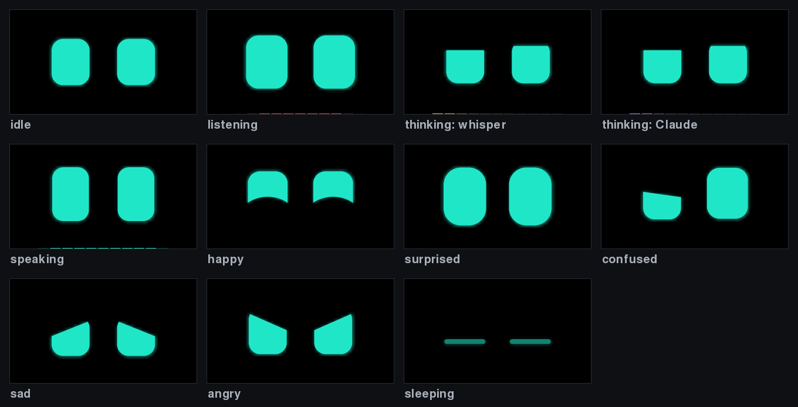
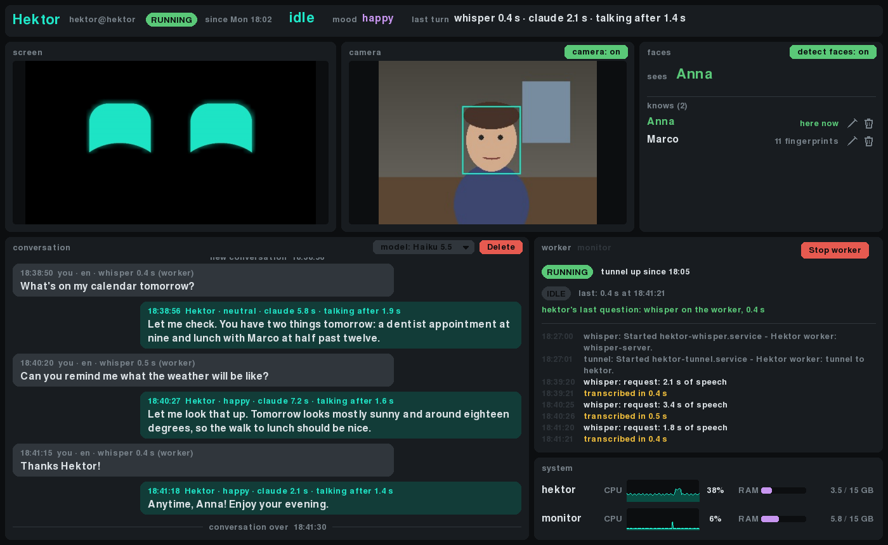

# Hektor

A desk robot face: a pair of animated eyes on a laptop screen that listens for
"hey hector", answers out loud with Claude as the brain, and shows what it's doing with its eyes and a
KITT-like stripe. It runs on **hektor**, an old laptop with Ubuntu, and is developed on **monitor**, the
computer that also runs the monitor app and the worker (which machines: `deploy.conf`, see
`deploy.conf.example`).





Status: runs on hektor, boots straight into the face. Eyes, voice, noises, camera, face recognition, the
worker and the monitor app work. What's still to do is in [plan.md](plan.md).

## Repo

```
app/                the app (Python, one process): eyes, voice, camera, noises — see app/README.md
  hektor.conf       all settings, commented
doc/                screenshots: the eyes, the monitor app (dev/run.sh screenshots redraws them)
dev/                developer tools: monitor, dev console, mic and wake word tests — see dev/README.md
ubuntu/             turning hektor into Hektor: setup.sh, deploy.sh, claude-token.sh — see ubuntu/README.md
worker/             monitor doing the speech to text for hektor, faster — see worker/README.md
plan.md             what is still to do, open questions
LICENSE             MIT
.vscode/            launch configs: window, full screen, eyes only, dev console, monitor
.claude/skills/     hektor: how Claude Code deploys to and looks after hektor
```

## Run it here

Needs Linux with Wayland or X11, PipeWire, Python 3.11+, `ffmpeg`, `espeak-ng`, `whisper-cli`
(whisper.cpp) and Claude Code (`claude`, logged in). Then, in `app/`:

```
./fetch-models.sh     # once: speech, wake word and face models (~250 MB, ~/.local/share/hektor)
./audio-setup.sh      # once, recommended: noise suppression + echo cancellation in PipeWire
./run.sh --window     # Hektor in a window (full screen without --window)
```

`run.sh` makes the venv on its first run. Say "hey hector" (or press `k`) and ask something.

| Command                      | What                                                         |
|------------------------------|--------------------------------------------------------------|
| `./run.sh --window`          | Hektor in a window; `--no-voice`, `--no-camera`, `--quiet` (no noises) |
| `./run.sh --say "Hello."`    | try the voice                                                 |
| `./run.sh --help`            | everything else (`--debug`, `--kiosk`, `--resolution`, ...)   |

The developer tools are in `dev/` (from the repo root, with the app's venv):

| Command                      | What                                                         |
|------------------------------|--------------------------------------------------------------|
| `dev/run.sh monitor`         | watch Hektor on hektor: running or not, state, the conversation, its screen and camera, CPU and RAM; the worker here, with a start / stop button, busy or not, its log |
| `dev/run.sh console`         | developer console: play every noise, live mic meter, type text to hear the voice |
| `dev/run.sh mic-test`        | mic level against the speech threshold, in the terminal      |
| `dev/run.sh wake-test`       | what the wake word spotter hears                              |
| `dev/run.sh sound all`       | hear all the noises                                           |

Keys, how the eyes, voice, camera and noises work, and the code layout: [app/README.md](app/README.md).

## On hektor

hektor logs in automatically as `hektor` (no sudo) into GNOME, where a user service runs Hektor full
screen and restarts it if it crashes; an admin account (`HEKTOR_ADMIN` in `deploy.conf`) does the setup. The code is an rsync copy of `app/`, `dev/`
and `ubuntu/`, no git there. From the repo root here:

```
ubuntu/deploy.sh              # "push to hektor": copy the code (uncommitted changes too) and restart
ubuntu/deploy.sh --setup      # first time, or after changing setup.sh (asks for the admin's sudo password)
ubuntu/claude-token.sh        # Claude login for the robot (long-lived token from `claude setup-token`)
dev/run.sh monitor            # watch it
```

Settings for hektor only are in `~hektor/.config/hektor/hektor.conf` there (deploys don't touch it);
right now: English only for whisper, 4 threads, quieter noises, camera off. Logs:
`~hektor/.local/state/hektor/hektor.log` and `journalctl --user -u hektor`. To see the screen over RDP:
GNOME Desktop Sharing as `hektor`, port 3390. All of it, step by step: [ubuntu/README.md](ubuntu/README.md).

## Privacy

Everything but Claude runs on the laptop: the wake word (Vosk), speech to text (whisper.cpp), the voice
(piper) and face detection (OpenCV) are offline. What you say goes to Claude as text, through Claude
Code on the claude.ai subscription; Claude can search the web and read, not change, Gmail, Calendar,
Drive and Claude Docs. Recordings aren't kept: the last one sits in `$XDG_RUNTIME_DIR/hektor` (RAM) until
the next. The camera picture and the screen are only shared with a running monitor, over SSH, and
deleted a few seconds after it closes. The Claude token is in a `chmod 600` file outside the repo.

## When it doesn't understand you

Look at the stripe at the bottom of the screen while you talk, or at the monitor's conversation:

| What you see                                   | Likely cause, and what to change (in `hektor.conf`)        |
|------------------------------------------------|------------------------------------------------------------|
| no reaction to "hey hector"                    | wake word missed: say it clearly, or press `k`; `dev/run.sh wake-test` shows what it hears |
| it wakes up by itself                          | thumps and noise taken for the wake phrase; the monitor shows "wake word ignored" for the ones caught |
| stripe stays dark while you talk               | your voice isn't counted as speech: lower `VOICED` (0.6 → 0.5) |
| stripe stays red long after you stop           | background noise counted as speech: raise `SILENCE_SHARE` (0.2 → 0.3) |
| "didn't catch that", or odd sentences          | noisy or muffled sound: give the laptop room (not boxed in), a USB mic near you helps most; the log shows what whisper heard |
| it answers in another language                 | set `WHISPER_LANGUAGE=en`                                   |
| slow answers                                   | whisper ~0.75 s on hektor (~0.55 s on the worker), Claude ~3 s; Hektor starts talking after Claude's first sentence. Check `whisper-server ready`, `claude warmed up`, `worker there` in the log (setup.sh builds whisper-server) |

The noise levels and thresholds of each recording are in the log ("listening ... noise, speech threshold",
"recorded ... loudest ... quiet under").

## License

MIT, see [LICENSE](LICENSE).
